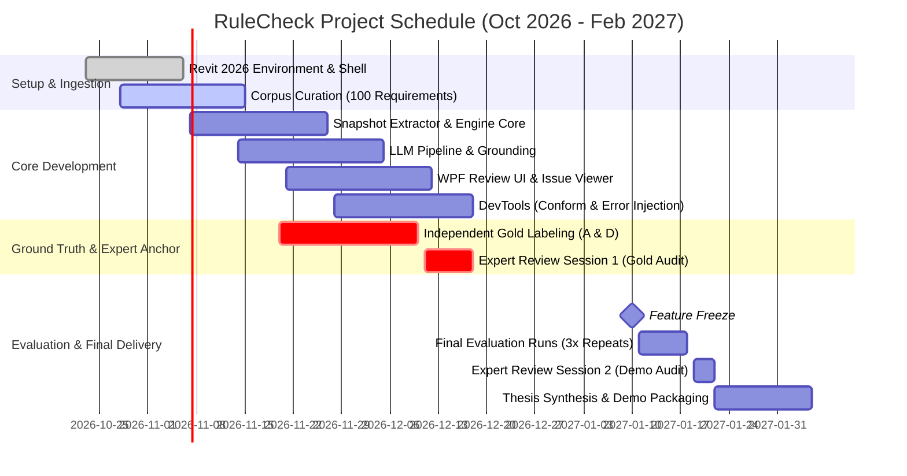

# PRD: AI-Assisted Revit Model QA/QC Checker (RuleCheck)

**Working title:** RuleCheck for Revit  
**Version:** 2.0 (Post Grill-Me Alignment) | **Date:** 23 Oct 2026 | **Target:** Academic Thesis / Capstone  
**Team:** 4 Students (Roles A, B, C, D) | **Deadline:** Early Feb 2027 (Feature Freeze: 10 Jan 2027)

---

## 1. Executive Summary & Success Statement

### 1.1 Product Vision
**RuleCheck** is a Revit 2026 add-in and automated QA/QC pipeline that converts unstructured requirements from BIM Execution Plans (BEP) and Employer's Information Requirements (EIR)—supplied as pasted text sections or spreadsheet tables—into structured, executable, deterministic validation rules. It presents these rules in a review screen with source-text traceability, runs validated rules against an extracted model snapshot, and outputs clickable issues that highlight and zoom to offending elements directly in Revit. The tool is strictly read-only and never modifies the BIM model.

### 1.2 Primary Project Goal
**Academic rigor and defensibility first.** The software is a vehicle for empirical research and formal evaluation. Business and commercialization chapters serve as secondary desk research to demonstrate market relevance rather than a venture launch.

### 1.3 Success Criteria
By February 2027, the team demonstrates:
1. **Rule Translation Quality:** The two-stage LLM pipeline achieves measurable schema-validity, expressibility coverage, and behavioral accuracy across ~100 standardized BEP requirements extracted from 3–5 public BIM standards (evaluated on a frozen, held-out 70-requirement test set, run 3× to report variance).
2. **Detection Precision & Recall:** End-to-end issue detection achieves high precision, recall, and F1 on Revit 2026 benchmark models (Autodesk sample models) evaluated against gold-standard rule sets on models with conformed shared parameters and systematically injected errors.
3. **Reproducibility & Modularity:** A headless snapshot architecture enables 100% reproducible command-line evaluation and unit testing with zero dependency on an active Revit UI session.
4. **Methodological Validity:** Gold rules are labeled independently by two annotators with reported inter-annotator agreement (Cohen's $\kappa$), anchored by an external BIM domain expert (academic lecturer or professional alumnus) for spot-checking and final review.

---

## 2. Problem Statement & Research Wedge

### 2.1 The Problem
- **ISO 19650 Compliance:** Quality checks and reviews are mandated project milestones; non-conformances must be logged and resolved.
- **Disconnected Requirements:** Rules govern naming conventions, parameter completeness, classification codes, and level assignments, yet they remain trapped in static BEP prose, LOIN matrices, or spreadsheets.
- **Manual Overhead:** Translating documents into checking configurations manually in tools like Solibri or Autodesk Model Checker Configurator is tedious and error-prone.

### 2.2 The Research Wedge
Instead of claiming minor speed gains over template-filling (where existing configurators already require only ~30–60 seconds per rule), **RuleCheck shifts the paradigm from manual rule entry to automated document ingestion:**
> *"Can an LLM reliably parse unstructured BEP clauses and LOIN tables into verified, deterministic Revit checking rules grounded against live model schema?"*

---

## 3. Comparative Landscape

| Tool | Approach | Limitations & Gap for RuleCheck |
|---|---|---|
| **Solibri** | Enterprise rule-based checking with predefined templates & roles. | Operates externally on IFC files; closed ecosystem; expensive licensing (£5k+); rules require manual template parameterization. |
| **Autodesk Model Checker for Revit** | Native add-in running XML-configured checksets; XML Configurator UI. | Free and native, but authoring checksets is purely manual; cannot parse BEP text or import ad-hoc project spreadsheets directly into rules. |
| **RuleCheck (Our System)** | Grounded LLM parser (BEP/Excel $\to$ JSON Schema) + Headless deterministic .NET 8 Engine + Thin Revit 2026 UI. | Direct document ingestion, grounded parameter resolution, transparent user review with source quotes, fully open and auditable academic pipeline. |

---

## 4. User Personas & Core Workflows

### 4.1 Target Personas
- **Primary:** BIM Coordinator / Information Manager enforcing BEP compliance before information exchange.
- **Secondary:** Lead BIM Modeler running pre-submission self-audits.

### 4.2 Core User Journey
1. **Ingest Requirements:** BIM Coordinator pastes a section of a BEP or imports an Excel/CSV parameter matrix into the add-in.
2. **Grounded Translation:** The system extracts the active model's parameter vocabulary (names + storage types, zero values), passes it to the LLM alongside the requirements, and generates candidate JSON rules.
3. **Review & Refine:** In a dedicated review pane, the user inspects each rule side-by-side with its source text excerpt. Unresolved parameters or inexpressible clauses are transparently flagged. The user edits or approves rules.
4. **Execute & Inspect:** The user runs approved rules. The engine evaluates the model snapshot deterministically and populates the sortable/filterable issue grid.
5. **Locate & Remediate:** Clicking any issue invokes `UIDocument.ShowElements`, focusing Revit's active view directly onto the problematic element.
6. **Export & Reuse:** The user exports findings to CSV and saves verified rule sets as JSON for subsequent audit cycles or project milestones.

---

## 5. System Scope

### 5.1 MVP Scope (Must Have for 10 Jan 2027 Feature Freeze)

| ID | Module | Requirements & Acceptance Criteria |
|---|---|---|
| **F1** | **Revit Add-in Shell** | Revit 2026 ribbon tab, dockable WPF pane scaffolded via `Nice3point.Revit.Templates`. Modeless actions route safely through an `ExternalEvent` queue. |
| **F2** | **Snapshot Extractor** | Fast, read-only extraction of model elements, categories, instance/type parameters, storage types, levels, and rooms into an in-memory/JSON snapshot. |
| **F3** | **Vocabulary Grounding** | Compiles model categories and parameter names (no parameter values) into typed enums to constrain LLM generation and detect missing/unresolved parameters. |
| **F4** | **Rule Engine (.NET 8)** | Headless, deterministic check engine supporting 6 core check types with optional AND-based target filters. Zero Revit API references. |
| **F5** | **Rule Schema** | Strict JSON Schema enforcing rule types, target categories, where-conditions, and severities, with support for `not_expressible` outcomes. |
| **F6** | **LLM Ingestion Pipeline** | 2-stage processing: (1) segment text into atomic requirements with verbatim quotes; (2) translate into structured rule schema constrained by model vocabulary. |
| **F7** | **Interactive Review Screen** | WPF review grid pairing source quotes with parsed rule drafts, status badges (`OK`, `Unresolved`, `Not Expressible`), and inline editing. |
| **F8** | **Manual Rule Editor** | Form-based rule authoring/editing allowing full manual control and offline operation without LLM access. |
| **F9** | **Issue Grid & Navigation** | Sortable/filterable issue viewer showing severity, element ID, category, level, rule violated, and error message. Triggers `ShowElements` on selection. |
| **F10** | **Import / Export** | Ingestion of Excel/CSV tables and plain text; export of issue logs to CSV; export of model snapshots to JSON; save/load of rule sets with vocabulary re-validation. |
| **F11** | **DevTools (Internal Only)** | Standalone internal add-in to conform test models (inject missing shared parameters) and systematically inject logged errors for evaluation. |

### 5.2 Out of Scope
- Automatic model editing or geometry healing.
- Clash detection or geometric collision analysis.
- Multi-version Revit support (pinned strictly to Revit 2026).
- Direct PDF/Word parsing (text is copied/pasted).
- HTML report generation and historical trend dashboards.
- Formal building code compliance certification.

---

## 6. Technical Architecture & Modularity

### 6.1 Architectural Decoupling
To ensure team agility and headless academic evaluation, the codebase is strictly partitioned:

```
[Revit 2026 Process]
  │
  ├── RuleCheck.RevitApp (WPF Dockable Pane, Ribbon, ExternalEvent Queue)
  │     │
  │     ├── SnapshotExtractor ──► ModelSnapshot (Memory / JSON file)
  │     └── ElementNavigator   ◄── Issue Element IDs (ShowElements)
  │
───────────────────────── Process / Assembly Boundary ─────────────────────────
  │
[Pure .NET 8 Class Libraries - Zero Revit Dependencies]
  │
  ├── RuleCheck.Core (Domain entities, ModelSnapshot, Issue models)
  ├── RuleCheck.Engine (Deterministic rule execution & condition evaluators)
  ├── RuleCheck.Schema (JSON Schema validator, serialization, rule definitions)
  ├── RuleCheck.LLM (ILlmClient, prompt templates, vocabulary grounding, segmentation)
  └── RuleCheck.Evaluation (CLI test harness, metric calculators, synthetic runner)
```

### 6.2 Target Environment
- **Revit Version:** Autodesk Revit 2026
- **Runtime:** .NET 8.0 (`net8.0-windows`)
- **IDE:** Visual Studio 2022
- **UI Framework:** WPF with `CommunityToolkit.Mvvm`

### 6.3 Rule Schema Specification
Rules are structured around a target selector, optional pre-filters, and exactly one deterministic check:

```json
{
  "$schema": "http://json-schema.org/draft-07/schema#",
  "title": "RuleCheckDefinition",
  "type": "object",
  "required": ["id", "name", "target", "check", "severity"],
  "properties": {
    "id": { "type": "string" },
    "name": { "type": "string" },
    "source_quote": { "type": "string" },
    "severity": { "type": "string", "enum": ["error", "warning", "info"] },
    "is_expressible": { "type": "boolean", "default": true },
    "unexpressible_reason": { "type": "string" },
    "target": {
      "type": "object",
      "required": ["categories"],
      "properties": {
        "categories": { "type": "array", "items": { "type": "string" } },
        "element_kind": { "type": "string", "enum": ["instance", "type", "both"], "default": "instance" },
        "where": {
          "type": "array",
          "items": {
            "type": "object",
            "required": ["parameter", "operator", "value"],
            "properties": {
              "parameter": { "type": "string" },
              "operator": { "type": "string", "enum": ["equals", "not_equals", "contains", "in", "greater_than", "less_than"] },
              "value": {}
            }
          }
        }
      }
    },
    "check": {
      "type": "object",
      "required": ["type"],
      "properties": {
        "type": {
          "type": "string",
          "enum": [
            "required_parameter",
            "pattern",
            "allowed_values",
            "range",
            "unique",
            "placement",
            "not_unused"
          ]
        },
        "parameter": { "type": "string" },
        "regex": { "type": "string" },
        "values": { "type": "array" },
        "min": { "type": "number" },
        "max": { "type": "number" },
        "scope": { "type": "string", "enum": ["model", "category", "level"] },
        "placement_kind": { "type": "string", "enum": ["room_assigned", "level_assigned"] }
      }
    }
  }
}
```

### 6.4 Privacy & LLM Grounding Guardrails
1. **Zero Model Values Exported:** The LLM receives only element category names and parameter identifiers; proprietary project coordinates, geometric meshes, and client values are never transmitted.
2. **Vocabulary Pre-Filtering:** Category-relevant parameters are passed as strict schema enums to eliminate hallucinated parameter names.
3. **Explicit Unresolved Handling:** If a required parameter is absent from the active model vocabulary, the rule is marked `unresolved` rather than guessed, providing actionable QA feedback.

---

## 7. Non-Functional Requirements (NFRs)

- **Determinism:** Given an identical model snapshot and rule set, the engine execution produces 100% identical issue sets across all runs.
- **Safety & Non-Destructive Operation:** The add-in opens zero modifying transactions on production models; all operations are strictly read-only.
- **Performance:** Model snapshot extraction and evaluation of 50 rules on a medium-sized project (~5,000 elements) completes in under 15 seconds.
- **Offline Reliability:** All checking features function completely without internet access via manual rule editing and pre-saved rule sets.

---

## 8. Scientific Evaluation Plan

### 8.1 Ground Truth Dataset Construction
- **Corpus:** 100 distinct requirement statements extracted verbatim from 3–5 public BIM specifications:
  - *AEC (UK) BIM Technology Protocol*
  - *NYC DDC BIM Guidelines*
  - *USACE / Penn State BIM Execution Plan templates*
  - *UK BIM Framework Information Requirements examples*
- **Dev / Test Split:** 30 requirements reserved for development, prompt engineering, and few-shot calibration; 70 requirements locked as a frozen held-out test set (split strictly by source document).
- **Gold Labeling Protocol:** Roles A and D independently translate the requirements into gold JSON rules. Disagreements are reconciled, and inter-rater reliability is reported via Cohen's $\kappa$.
- **Expert Anchor:** A university BIM lecturer or industry alumnus validates a 20-rule sample in mid-December and reviews the final evaluation outputs in January.

### 8.2 Test Models & Conformance
- **Benchmark Models:** Official Autodesk Revit 2026 Sample Projects (Architecture, Structure, MEP).
- **Two-Stage DevTools:**
  1. *Conformance Stage:* Injects required shared parameters and sets valid default values so the baseline model passes 100% of gold rules.
  2. *Error Injection Stage:* Introduces discrete, logged corruptions (e.g., cleared values, malformed naming codes, duplicate tags, detached rooms).

### 8.3 Evaluation Metrics

| Metric | Target / Evaluation Scope | Significance |
|---|---|---|
| **Expressibility Coverage** | % of corpus clauses expressible in rule schema | Quantifies expressiveness limits of the DSL. |
| **Classification Accuracy** | Precision/Recall for `not_expressible` & `unresolved` | Demonstrates AI prudence vs. dangerous hallucination. |
| **Behavioral Rule Match** | % of generated rules yielding identical issue sets to gold | Evaluates true functional equivalence over brittle JSON string diffing. |
| **Issue Precision / Recall / F1** | Issue-level comparison: $P, R, F_1$ against injected errors | Measures end-to-end practical defect detection. |
| **LLM Variance** | Mean $\pm$ std dev across 3 identical runs ($T=0$) | Assesses prompt stability and non-determinism. |
| **Execution Performance** | Extraction time + check evaluation time | Confirms scalability across element quantities. |

---

## 9. Team Structure & Allocation

```
Role A: Revit Layer & DevTools (Strongest C# Engineer)
  ├── Add-in lifecycle, ribbon, dockable panel, ExternalEvent queue
  ├── Snapshot extraction pipeline & Revit ShowElements integration
  ├── Internal DevTools (model conformance & error injection engine)
  └── Evaluator / Gold Annotator 2

Role B: Engine & Schema Lead
  ├── Rule schema specification, serialization, & validator
  ├── Deterministic .NET 8 evaluation engine & condition evaluators
  ├── Unit testing suite for headless snapshot checks
  └── Rule-set serialization, persistence, & vocabulary re-validation

Role C: LLM & Data Pipeline (AI Experience)
  ├── Two-stage LLM pipeline (segmentation & grounded translation)
  ├── Model vocabulary extraction, category indexing, & prompt engineering
  ├── Excel / CSV parsing modules
  └── Automated evaluation harness & metric computation CLI (blind to held-out test set)

Role D: UI, Evaluation Corpus & Research Lead
  ├── WPF MVVM review screen, issue grid, and manual rule editor
  ├── Public BEP corpus curation (~100 items) & dev/test partitioning
  ├── Gold Annotator 1, Cohen's κ calculation, & Domain Expert liaison
  └── Desk research for business chapter & thesis report structure
```

---

## 10. Milestone Timeline & Critical Path



> [!CAUTION]
> **Critical Path Warning:** Gold rule labeling and model conformance dictate when end-to-end evaluation can start. Labeling must complete by mid-December before the holiday slowdown to safeguard the 10 January freeze.

---

## 11. Risk Management

| Risk | Impact | Probability | Mitigation Strategy |
|---|---|---|---|
| **Revit API Threading Crashes** | High | Medium | Enforce strict isolation: all Revit calls execute through a centralized, thread-safe `ExternalEvent` queue. |
| **Model Vocabulary Enum Overflow** | Medium | Medium | Pre-filter vocabulary strictly by category prior to prompt generation, keeping schema tokens within LLM context boundaries. |
| **LLM Output Non-Determinism** | Medium | High | Fix temperature to 0; enforce JSON Schema strict mode; run the held-out test set 3 times and report mean and spread. |
| **Schedule Slip on Ground Truth** | High | Medium | Decouple test set annotation early; utilize Dev set (30 items) for preliminary pipeline verification. |
| **Model Version Incompatibilities** | High | Low | Lock all machines strictly to Revit 2026; do not open test files in subsequent releases. |

---

## 12. Definition of Done (DoD)

- [ ] Add-in loads without warning in Revit 2026 via clean installer or setup script.
- [ ] Model snapshot extracts accurately for architectural, structural, and MEP categories.
- [ ] Rule engine passes 100% of headless unit tests across all 6 check types and filter predicates.
- [ ] Two-stage LLM pipeline produces strictly valid JSON schema output with grounded model vocabulary.
- [ ] Review UI allows editing, approving, and manual creation of rules.
- [ ] Issue viewer correctly triggers `ShowElements` on clicked issues in an active Revit view.
- [ ] Gold ground-truth annotations completed with reported Cohen's $\kappa$ and external expert sign-off.
- [ ] Automated evaluation CLI executes 3× on the held-out test set, exporting complete metric tables ($P, R, F_1$, coverage, execution times).
- [ ] Source repository, setup documentation, demonstration video, and final academic thesis delivered.
